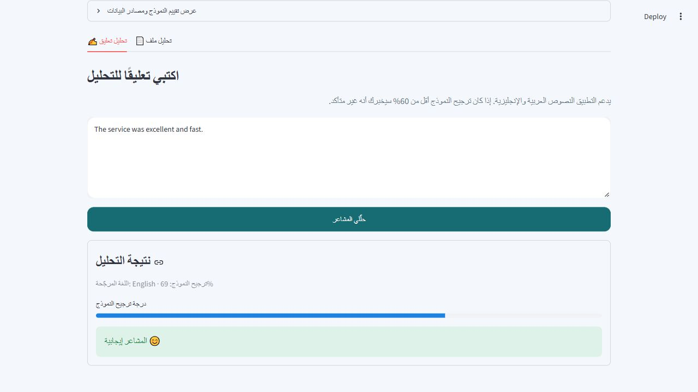

# Bilingual Social Media Sentiment Analyzer

A bilingual Arabic-English web app that classifies social media posts as positive or negative, and reports uncertainty when the model score is low.

## Features

- Analyze one post or upload a batch of comments.
- Supports CSV, Excel, JSON, TXT, and Markdown files.
- Shows the likely language and model confidence.
- Includes separate Arabic and English evaluation results.

## Tech stack

Python · Streamlit · pandas · scikit-learn · TF-IDF · Logistic Regression

## Project files

- [App source](bilingual-sentiment-analyzer-upload-ready/app.py)
- [Full bilingual README and setup guide](bilingual-sentiment-analyzer-upload-ready/README.md)
- [Data sources and license notes](bilingual-sentiment-analyzer-upload-ready/DATA_SOURCES.md)
- [Dependencies](bilingual-sentiment-analyzer-upload-ready/requirements.txt)

The training dataset is not included in this repository.
