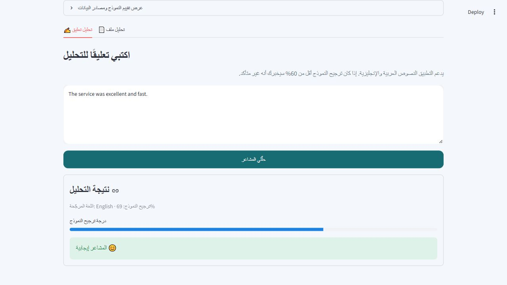

# Bilingual Social Media Sentiment Analyzer



## العربية

تطبيق ويب بسيط يحلّل مشاعر المنشورات والتعليقات بالعربية والإنجليزية، ويصنّفها إلى إيجابية أو سلبية. إذا كان ترجيح النموذج أقل من 60%، يعرض النتيجة على أنها «غير متأكد» بدلًا من إعطاء تصنيف واثق.

### المميزات

- تحليل تعليق واحد أو مجموعة تعليقات.
- دعم ملفات CSV وExcel (`.xlsx`) وJSON وTXT وMarkdown.
- عرض اللغة المرجّحة ودرجة ترجيح النموذج.
- تنزيل نتائج التحليل الجماعي كملف CSV.
- عرض تقييم منفصل لأداء النموذج على العربية والإنجليزية.

### طريقة التشغيل

تحتاج إلى Python 3.10 أو أحدث. ثبّت المكتبات المطلوبة:

```bash
python -m pip install streamlit pandas scikit-learn
```

من مجلد المشروع شغّل:

```bash
python -m streamlit run app.py
```

سيفتح Streamlit التطبيق في المتصفح. يحتاج ملف البيانات `data/social_posts.csv` إلى الأعمدة `text` و`label` و`language`.

### رفع التعليقات

- في CSV وExcel: أضيفي عمودًا اسمه `text` أو `review` أو `comment`.
- في TXT وMarkdown: ضعي تعليقًا واحدًا في كل سطر.
- في JSON: استخدمي قائمة من النصوص أو قائمة من السجلات التي تحتوي على أحد أسماء الأعمدة السابقة. يمكن أيضًا وضع القائمة داخل مفتاح مثل `comments` أو `reviews` أو `posts` أو `data`.

### البيانات والنتائج

تضم عينة المشروع 25,905 منشورات بعد إزالة التكرارات: 15,907 بالعربية و9,998 بالإنجليزية. يستخدم التطبيق تقسيمًا للتدريب والتقييم بنسبة 80/20، ويعرض نتيجة كل لغة في قسم تقييم النموذج.

في آخر تقييم مسجّل لهذه النسخة، بلغت الدقة **82.43% للعربية** على 3,181 منشور تقييم، و**82.70% للإنجليزية** على 2,000 منشور تقييم. هذه النتائج تخص مجموعة البيانات الحالية ولا تضمن الأداء نفسه مع كل اللهجات أو المواضيع أو السخرية.

مصادر البيانات وتفاصيل التراخيص موضّحة في [`DATA_SOURCES.md`](DATA_SOURCES.md). ملف المنشورات نفسه غير مضمّن في مستودع GitHub؛ جهّزي `data/social_posts.csv` محليًا من المصادر المذكورة، وراجعي شروط كل مصدر قبل إعادة توزيع البيانات.

---

## English

A small web app that analyzes Arabic and English social media posts and comments, classifying them as positive or negative. When the model's highest score is below 60%, the app reports **uncertain** instead of presenting a confident label.

### Features

- Analyze one comment or a batch of comments.
- Accept CSV, Excel (`.xlsx`), JSON, TXT, and Markdown files.
- Show the likely language and the model score.
- Download batch results as a CSV file.
- View separate evaluation results for Arabic and English.

### Run the app

Python 3.10 or newer is required. Install the dependencies:

```bash
python -m pip install streamlit pandas scikit-learn
```

From the project folder, run:

```bash
python -m streamlit run app.py
```

Streamlit opens the app in a browser. The training file `data/social_posts.csv` must contain `text`, `label`, and `language` columns.

### Upload formats

- CSV and Excel files need a `text`, `review`, or `comment` column.
- TXT and Markdown files should contain one comment per line.
- JSON can be a list of strings or records containing one of those text columns. A list can also be nested under `comments`, `reviews`, `posts`, or `data`.

### Data and results

The project dataset contains 25,905 deduplicated posts: 15,907 Arabic and 9,998 English. The app uses an 80/20 train/evaluation split and reports results for each language separately.

In the latest recorded evaluation for this version, accuracy was **82.43% for Arabic** across 3,181 evaluation posts and **82.70% for English** across 2,000 evaluation posts. These results describe this dataset and do not guarantee the same performance across every dialect, topic, or sarcastic post.

Dataset sources and license notes are listed in [`DATA_SOURCES.md`](DATA_SOURCES.md). The posts file is not included in the GitHub repository; prepare `data/social_posts.csv` locally from the listed sources. Review each source's terms before redistributing its data.
